# Proyecto Final: Automatización del reporte diario del clima de Guadalajara mediante n8n y MCP

## Mis datos

- **Nombre:** Morales Hernández Dora Alicia
- **Carrera:** Ingenieria en computación (INCO)
- **Materia:** Computación Tolerante a Fallas
- **Docente:** López Franco, Michel Emanuel
- **Ciclo escolar:** 2026B
  
## Índice

1. Introducción
2. Planteamiento del problema
3. Objetivos
4. Fundamentos teóricos
   - 4.1. ¿Qué es n8n?
   - 4.2. Comparación entre n8n, Zapier y Make
   - 4.3. ¿Qué es la automatización de flujos de trabajo?
   - 4.4. ¿Qué es una API?
   - 4.5. ¿Qué es un webhook?
   - 4.6. ¿Qué es la inteligencia artificial generativa?
   - 4.7. ¿Qué es Model Context Protocol (MCP)?
   - 4.8. Diferencias entre cliente y servidor MCP
   - 4.9. Herramientas y recursos de MCP
   - 4.10. ¿Cómo decide un modelo cuándo utilizar una herramienta?
5. Descripción general de la solución
6. Tecnologías utilizadas
7. Arquitectura del proyecto
8. Desarrollo del flujo principal
   - 8.1. Schedule Trigger
   - 8.2. HTTP Request
   - 8.3. Edit Fields
   - 8.4. AI Agent y Gemini
   - 8.5. MCP Client Tool
   - 8.6. Gmail
9. Desarrollo del servidor MCP
   - 9.1. MCP Server Trigger
   - 9.2. Call n8n Workflow Tool
10. Desarrollo de la herramienta MCP
    - 10.1. When Executed by Another Workflow
    - 10.2. HTTP Request
11. Integración entre n8n, Gemini y MCP
12. Pruebas realizadas y resultados
13. Problema encontrado y solución
14. Consideraciones de seguridad
15. Limitaciones y posibles mejoras
16. Aprendizajes obtenidos
17. Conclusión
18. Bibliografía

---

# 1. Introducción

En este proyecto desarrollé una automatización utilizando n8n, inteligencia artificial y Model Context Protocol (MCP) para consultar información meteorológica de Guadalajara, Jalisco, generar un resumen del clima y enviarlo por correo electrónico.

La idea surgió de una tarea cotidiana: consultar el pronóstico del tiempo cada mañana. En lugar de realizar esta actividad manualmente, decidí crear un flujo que pudiera ejecutar la consulta de acuerdo con un horario establecido y enviar el resultado por correo.

Para obtener la información meteorológica utilicé la API de Open-Meteo mediante un nodo HTTP Request. Después organicé los datos con Edit Fields y configuré un agente de inteligencia artificial que utiliza Gemini para generar el resumen.

Además, integré una herramienta MCP mediante tres componentes principales: un cliente MCP conectado al agente, un flujo que funciona como servidor MCP y un flujo auxiliar que consulta la API meteorológica.

El proyecto se compone de tres flujos de trabajo. El primero realiza la automatización principal y envía el correo. El segundo proporciona el servidor MCP y permite acceder a una herramienta. El tercero ejecuta la consulta meteorológica cuando es invocado.

Durante el desarrollo realicé pruebas para comprobar el funcionamiento de los nodos y la transferencia de datos. También encontré un problema en el que la herramienta MCP devolvía una respuesta vacía. Al revisar la configuración, identifiqué un nodo Edit Fields que no tenía campos configurados, lo eliminé y volví a probar el flujo. Después de la corrección, la herramienta devolvió información meteorológica.

Finalmente, el flujo principal quedó publicado y el correo con la notificación del clima de las 8:00 a. m. llegó correctamente. Este resultado permitió comprobar que la automatización funcionó durante las ejecuciones realizadas.

# 2. Planteamiento del problema

Consultar el clima diariamente es una actividad sencilla, pero requiere entrar a un servicio meteorológico, revisar la información y preparar un resumen que permita conocer las condiciones del día.

El problema que decidí resolver fue evitar tener que realizar estos pasos manualmente cada mañana.

Para ello, planteé desarrollar un flujo de trabajo que consultara la información meteorológica de Guadalajara, seleccionara los datos necesarios, generara un resumen mediante inteligencia artificial y lo enviara por correo electrónico.

También quise experimentar con MCP para comprender cómo se puede conectar un agente de inteligencia artificial con una herramienta externa que realiza una consulta a una API.

La solución debía cumplir dos propósitos: automatizar una tarea útil por sí misma y demostrar la integración entre n8n, un modelo de lenguaje y una herramienta MCP.

# 3. Objetivos

## 3.1. Objetivo general

Desarrollar una automatización con n8n que consulte información meteorológica de Guadalajara, organice los datos, genere un resumen mediante inteligencia artificial y lo envíe por correo electrónico, incorporando una herramienta MCP para experimentar con la comunicación entre un agente y un servicio externo.

## 3.2. Objetivos específicos

- Crear un flujo de trabajo que se ejecute diariamente según un horario establecido.
- Consultar información meteorológica mediante una API pública.
- Utilizar expresiones de n8n para seleccionar y organizar los datos.
- Integrar Gemini mediante un nodo AI Agent para generar el resumen.
- Conectar una herramienta MCP al agente de inteligencia artificial.
- Configurar un servidor MCP que permita acceder a una herramienta de consulta meteorológica.
- Utilizar un flujo auxiliar para realizar la consulta a Open-Meteo.
- Enviar el resultado generado mediante Gmail.
- Probar los flujos, revisar los resultados y corregir los problemas encontrados.
- Documentar el funcionamiento del proyecto y los aprendizajes obtenidos.

# 4. Fundamentos teóricos

## 4.1. ¿Qué es n8n?

n8n es una plataforma de automatización que permite conectar aplicaciones, servicios y APIs mediante flujos de trabajo visuales.

Los flujos se construyen utilizando nodos. Cada nodo realiza una operación determinada y se conecta con otros para establecer el orden en el que se ejecutan las tareas.

Por ejemplo, un flujo puede comenzar con un disparador programado, continuar con una consulta a una API, procesar los datos y terminar enviando un correo electrónico.

En mi proyecto utilicé n8n para coordinar todas las etapas de la automatización. Esto me permitió conectar la consulta meteorológica, la organización de los datos, la inteligencia artificial, la herramienta MCP y Gmail dentro de un mismo sistema.

## 4.2. Comparación entre n8n, Zapier y Make

n8n, Zapier y Make son plataformas que permiten automatizar tareas mediante la conexión de diferentes servicios. Sin embargo, tienen diferencias en su forma de trabajar y en las opciones de personalización que ofrecen.

| Plataforma | Características generales |
|---|---|
| n8n | Permite crear flujos mediante nodos, utilizar expresiones, integrar APIs y trabajar con herramientas de inteligencia artificial. También ofrece opciones de alojamiento propio y en la nube. |
| Zapier | Se enfoca en conectar aplicaciones y automatizar tareas mediante una configuración guiada. Es útil para crear automatizaciones entre servicios compatibles. |
| Make | Permite diseñar escenarios visuales con módulos, rutas y operaciones que conectan diferentes aplicaciones y servicios. |

Las tres plataformas permiten automatizar procesos, pero la elección depende de las necesidades del proyecto, las integraciones requeridas y el nivel de personalización.

Elegí n8n porque necesitaba conectar varios componentes en un mismo proceso: una API meteorológica, expresiones para organizar datos, un agente de inteligencia artificial, una herramienta MCP y un servicio de correo electrónico.

La estructura basada en nodos me permitió visualizar el recorrido de la información y revisar las salidas de cada etapa durante las pruebas.

## 4.3. ¿Qué es la automatización de flujos de trabajo?

La automatización de flujos de trabajo consiste en organizar diferentes tareas para que se ejecuten de manera automática siguiendo una secuencia o una condición.

Un flujo puede iniciarse por un horario, por la llegada de un evento o por una solicitud externa. Después ejecuta las acciones que se hayan configurado.

En mi proyecto, el proceso comienza con Schedule Trigger, continúa con la consulta meteorológica y la generación del resumen, y termina con el envío del correo.

De esta manera, la automatización reduce la necesidad de realizar manualmente la consulta y el envío del reporte.

## 4.4. ¿Qué es una API?

Una API es una interfaz que permite que diferentes aplicaciones intercambien información o soliciten operaciones mediante reglas definidas.

En este proyecto utilicé la API de Open-Meteo para obtener información meteorológica. El nodo HTTP Request realiza una solicitud y recibe una respuesta que n8n puede procesar.

La respuesta contiene diferentes campos organizados en una estructura de datos. Mediante expresiones, los nodos posteriores pueden recuperar los valores que necesitan.

## 4.5. ¿Qué es un webhook?

Un webhook permite que una aplicación envíe información a otra cuando ocurre un evento. En n8n, el nodo Webhook puede recibir solicitudes HTTP externas y utilizar esa información para iniciar un flujo de trabajo.

Por ejemplo, una aplicación podría enviar una solicitud a n8n cuando se registra una nueva compra. El flujo podría utilizar los datos recibidos para enviar un correo o actualizar otro sistema.

En mi proyecto, el flujo principal utiliza Schedule Trigger, por lo que se inicia de acuerdo con un horario y no por la recepción de un webhook independiente.

También utilicé MCP Server Trigger con transporte HTTP Streamable. Aunque los webhooks y MCP pueden utilizar comunicación HTTP, no son lo mismo.

Un webhook recibe solicitudes para iniciar o atender un flujo, mientras que MCP establece una comunicación estandarizada entre clientes y servidores para acceder a herramientas y otras capacidades.

Por lo tanto, el proyecto utiliza un disparador programado y componentes MCP, pero no se debe afirmar que implementé un nodo Webhook independiente.

## 4.6. ¿Qué es la inteligencia artificial generativa?

La inteligencia artificial generativa puede producir contenido, como texto, a partir de instrucciones y datos de entrada.

En este proyecto utilicé Gemini mediante el nodo AI Agent para generar un resumen del clima a partir de la información disponible.

Es importante distinguir entre la obtención de los datos y la generación del mensaje. Open-Meteo proporciona la información meteorológica, mientras que el agente utiliza los datos y las instrucciones configuradas para redactar el resumen.

La respuesta generada por el agente se utiliza posteriormente como contenido del correo electrónico.

## 4.7. ¿Qué es Model Context Protocol (MCP)?

Model Context Protocol, conocido como MCP, es un protocolo que permite conectar aplicaciones de inteligencia artificial con herramientas y fuentes de información externas mediante una estructura estandarizada.

Un modelo de lenguaje puede generar respuestas a partir del contexto que recibe, pero algunas tareas requieren consultar datos externos o ejecutar operaciones. MCP facilita esa conexión entre el modelo, el cliente y los servicios que proporcionan las herramientas.

En mi proyecto, MCP permite conectar el agente de inteligencia artificial con una herramienta que consulta información meteorológica mediante una API.

La finalidad de esta integración es experimentar con la forma en que un agente puede disponer de una herramienta externa para obtener información adicional.

## 4.8. Diferencias entre cliente y servidor MCP

El cliente MCP es el componente que se comunica con un servidor y solicita el acceso a las capacidades que este ofrece.

El servidor MCP es el componente que expone esas capacidades y atiende las solicitudes del cliente.

En mi proyecto, el nodo MCP Client Tool está conectado al AI Agent y permite que el agente disponga de la herramienta MCP.

Por otra parte, el flujo Servidor MCP del Clima utiliza MCP Server Trigger y Call n8n Workflow Tool para proporcionar acceso al flujo auxiliar.

En términos sencillos, el cliente solicita el uso de una herramienta y el servidor permite acceder a ella.

## 4.9. Herramientas y recursos de MCP

Las herramientas y los recursos son conceptos diferentes dentro de MCP.

**Herramientas:** permiten solicitar la ejecución de una operación. Por ejemplo, una herramienta puede consultar una API, buscar información o ejecutar una tarea disponible en el servidor.

En mi proyecto, la herramienta MCP permite ejecutar un flujo auxiliar que consulta Open-Meteo y devuelve datos meteorológicos.

**Recursos:** son fuentes de información que un servidor puede exponer para proporcionar contexto a una aplicación. Pueden representar documentos, registros u otros datos disponibles para consulta.

La diferencia principal es que una herramienta permite solicitar una operación, mientras que un recurso proporciona información o contenido.

En la implementación descrita, la consulta meteorológica está configurada como una herramienta. No se creó ni se documentó un recurso MCP independiente.

## 4.10. ¿Cómo decide un modelo cuándo utilizar una herramienta?

Un modelo puede recibir instrucciones, conocer las herramientas disponibles y utilizar sus descripciones para determinar si alguna puede ayudarle a responder una solicitud.

La decisión depende de la petición, del contexto, de las instrucciones del agente y de las capacidades disponibles.

En mi proyecto, las instrucciones del AI Agent indican que debe intentar utilizar la herramienta MCP antes de generar el resumen y que debe señalar si la herramienta no está disponible o presenta un error.

Sin embargo, conectar una herramienta no garantiza que se ejecute automáticamente en todas las ocasiones. Su utilización depende de la configuración del agente y del comportamiento del modelo durante la ejecución.

Cuando una herramienta devuelve información, el agente puede utilizar ese resultado para preparar su respuesta.

# 5. Descripción general de la solución

La solución consiste en automatizar la consulta meteorológica de Guadalajara y enviar un resumen por correo electrónico.

Para lograrlo, desarrollé tres flujos de trabajo.

**Flujo 1: Flujo principal**

Consulta directamente la API meteorológica, organiza los datos, utiliza el agente de inteligencia artificial y envía el correo.

**Flujo 2: Servidor MCP del Clima**

Proporciona el punto de entrada del servidor MCP y permite invocar el flujo auxiliar.

**Flujo 3: Herramienta MCP - Datos del clima**

Se ejecuta cuando otro flujo la invoca y realiza una solicitud a Open-Meteo para devolver información meteorológica.

La consulta directa del flujo principal y la consulta realizada por la herramienta MCP son operaciones independientes. Si ambas se ejecutan, se pueden realizar dos solicitudes a la API.

Esta estructura permite mantener separada la automatización principal de la herramienta utilizada para experimentar con MCP.

# 6. Tecnologías utilizadas

| Tecnología | Función dentro del proyecto |
|---|---|
| n8n | Coordinar y ejecutar los flujos de trabajo. |
| Open-Meteo | Proporcionar información meteorológica. |
| HTTP Request | Realizar solicitudes a la API. |
| Edit Fields | Seleccionar y organizar los datos. |
| Gemini | Generar el resumen mediante inteligencia artificial. |
| AI Agent | Procesar las instrucciones y generar una respuesta. |
| MCP Client Tool | Conectar el agente con la herramienta MCP. |
| MCP Server Trigger | Proporcionar el punto de entrada del servidor MCP. |
| Call n8n Workflow Tool | Invocar el flujo auxiliar desde el servidor MCP. |
| When Executed by Another Workflow | Permitir la ejecución del flujo auxiliar por otro flujo de n8n. |
| Gmail | Enviar el resumen por correo electrónico. |

# 7. Arquitectura del proyecto

## 7.1. Flujo principal

La estructura del flujo principal es:

`Schedule Trigger → HTTP Request → Edit Fields → AI Agent → Gmail`

Cada nodo cumple una función específica dentro del proceso.

La siguiente captura muestra los nodos conectados del proyecto.

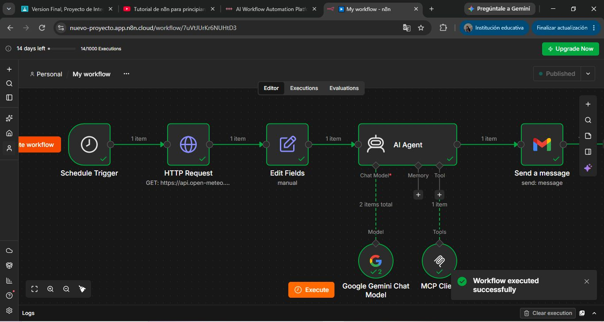

1. Schedule Trigger inicia el flujo según el horario configurado.

2. HTTP Request consulta Open-Meteo.

3. Edit Fields selecciona y organiza los datos necesarios. 

4. AI Agent utiliza Gemini para generar el resumen y dispone de una herramienta MCP conectada.

5. Gmail envía la salida del agente por correo electrónico.

## 7.2. Servidor MCP del clima

La estructura del servidor MCP es:

`MCP Server Trigger → Call n8n Workflow Tool`

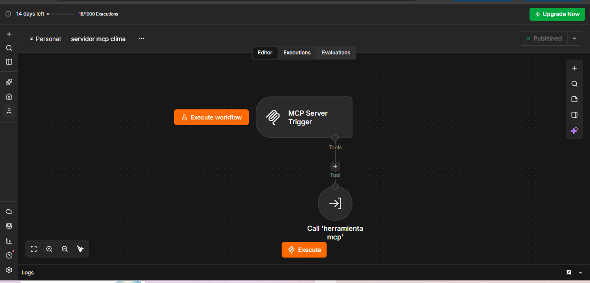

Este flujo permite acceder a la herramienta que ejecuta la consulta meteorológica auxiliar.

## 7.3. Herramienta MCP - Datos del clima

La estructura del flujo auxiliar es:

`When Executed by Another Workflow → HTTP Request`

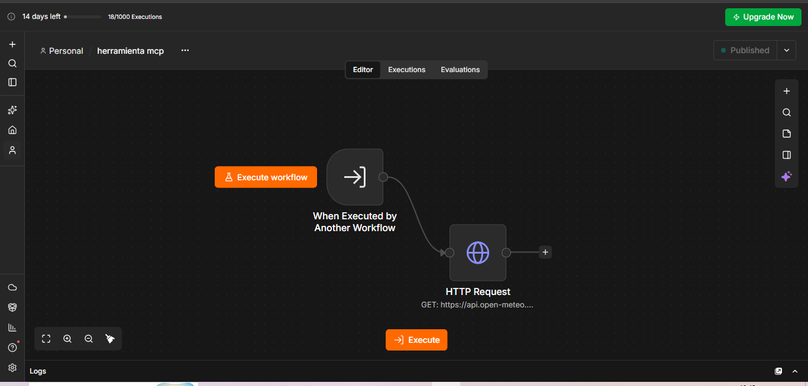

Este flujo recibe la solicitud de ejecución, consulta la API y devuelve la respuesta meteorológica.

## 7.4. Relación entre los tres flujos

El flujo principal realiza su propia consulta a Open-Meteo. Además, el agente tiene conectada una herramienta MCP que puede utilizar para solicitar otra consulta mediante el servidor.

El servidor MCP permite acceder al flujo auxiliar, que vuelve a consultar Open-Meteo cuando es invocado.

Por lo tanto, los tres flujos tienen responsabilidades diferentes: el principal prepara y envía el reporte, el servidor expone la herramienta y el flujo auxiliar realiza la consulta solicitada mediante MCP.

# 8. Desarrollo del flujo principal

## 8.1. Schedule Trigger: programación de la ejecución

Schedule Trigger permite iniciar un flujo de trabajo de acuerdo con un horario establecido.

En este proyecto se configuró para ejecutarse diariamente a las 8:00 a. m., utilizando la zona horaria `America/Mexico_City`.

Esta configuración permite programar la consulta meteorológica sin tener que iniciar manualmente cada ejecución.

Durante el desarrollo también se realizó una ejecución manual para revisar el comportamiento del flujo completo. Posteriormente, el flujo quedó publicado y se recibió el correo de notificación del clima de las 8:00 a. m.

Para que las ejecuciones programadas continúen funcionando, el entorno de n8n y las conexiones necesarias deben permanecer disponibles.

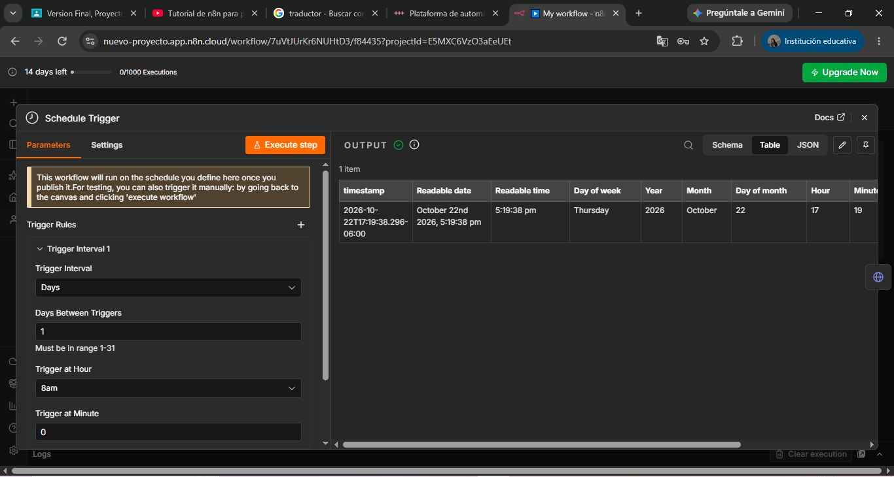

## 8.2. HTTP Request: consulta de Open-Meteo

El nodo HTTP Request realiza una solicitud GET a la API de Open-Meteo.

La dirección utilizada es:

`https://api.open-meteo.com/v1/forecast?latitude=20.6597&longitude=-103.3496&current=temperature_2m,relative_humidity_2m,apparent_temperature,is_day,precipitation,weather_code,wind_speed_10m&daily=temperature_2m_max,temperature_2m_min,precipitation_probability_max&timezone=America%2FMexico_City`

La solicitud utiliza las coordenadas de Guadalajara, Jalisco, para consultar los datos meteorológicos correspondientes a esa ubicación.

Entre los datos solicitados se encuentran:

- Temperatura actual.
- Humedad relativa actual.
- Sensación térmica.
- Indicador de día o noche.
- Precipitación.
- Código meteorológico.
- Velocidad del viento.
- Temperatura máxima diaria.
- Temperatura mínima diaria.
- Probabilidad máxima de precipitación.

La API devuelve una estructura de datos que los nodos posteriores pueden utilizar.

Aunque la solicitud incluye varios campos, el nodo Edit Fields selecciona los valores necesarios para el resumen configurado.

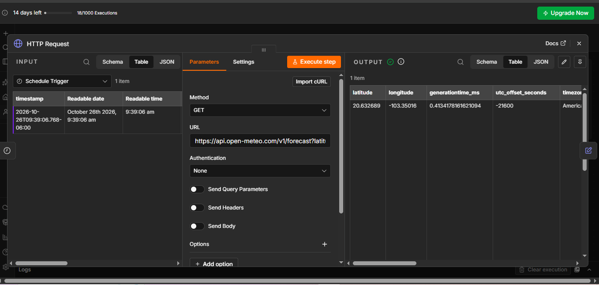

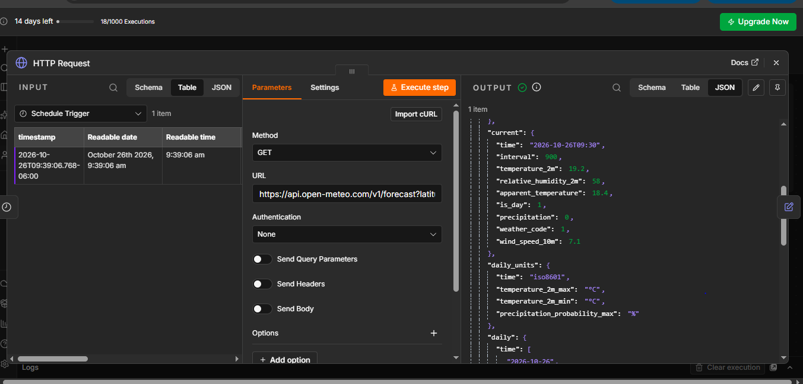

## 8.3. Edit Fields: organización de los datos

Después de obtener la respuesta de Open-Meteo, el nodo Edit Fields selecciona y organiza los campos que se utilizarán en el flujo principal.

La configuración utilizada es la siguiente:

| Campo | Valor o expresión | Función |
|---|---|---|
| `ciudad` | `Guadalajara, Jalisco` | Identificar la ubicación. |
| `temperatura` | `{{ $json.current.temperature_2m }}` | Recuperar la temperatura actual. |
| `humedad` | `{{ $json.current.relative_humidity_2m }}` | Recuperar la humedad relativa. |
| `temperatura_maxima` | `{{ $json.daily.temperature_2m_max[0] }}` | Recuperar la máxima del primer día devuelto. |
| `temperatura_minima` | `{{ $json.daily.temperature_2m_min[0] }}` | Recuperar la mínima del primer día devuelto. |

Las expresiones permiten recuperar valores de la respuesta del nodo anterior.

Por ejemplo, `{{ $json.current.temperature_2m }}` accede al valor de temperatura actual dentro del objeto `current`.

En los campos de temperatura máxima y mínima se utiliza `[0]` para recuperar el primer elemento de las listas diarias.

Este nodo permite entregar al agente una estructura de datos más sencilla y centrada en la información necesaria para el resumen.

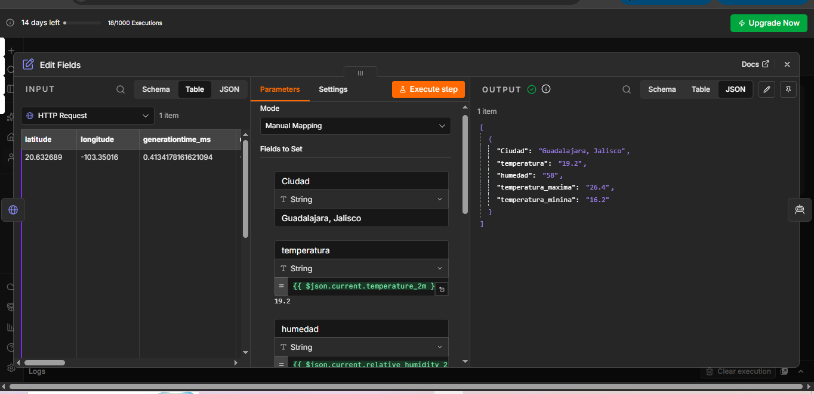 

## 8.4. AI Agent y Gemini: generación del resumen

El nodo AI Agent se utiliza para generar el texto que se enviará por correo electrónico. Está configurado para trabajar con Gemini y cuenta con una herramienta MCP conectada.

Las instrucciones del agente indican que debe intentar utilizar la herramienta MCP antes de redactar el resumen y señalar si la herramienta no está disponible o presenta un error.

El agente recibe la información organizada por el flujo y utiliza el modelo de inteligencia artificial para producir un mensaje comprensible.

La generación del resumen depende de los datos de entrada, las instrucciones configuradas, la disponibilidad del modelo y el resultado de las herramientas que utilice.

Durante las pruebas se comprobó que el agente produjera una salida que pudiera utilizarse en el siguiente nodo.

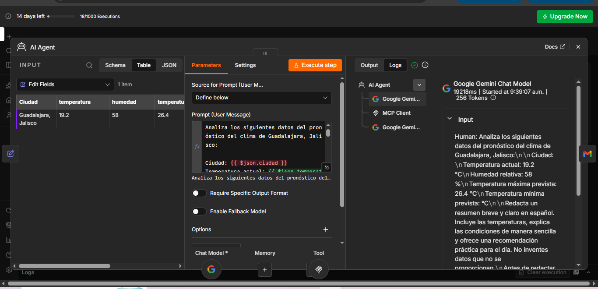  

## 8.5. MCP Client Tool: conexión con la herramienta

MCP Client Tool está conectado al AI Agent para que el agente disponga de una herramienta externa.

Esta herramienta se relaciona con el servidor MCP del clima, que permite acceder al flujo auxiliar encargado de consultar la API meteorológica.

La conexión permite que el agente solicite información mediante MCP cuando corresponda.

Es importante distinguir entre tener una herramienta conectada y comprobar que se utilizó en una ejecución específica. Para demostrar una llamada concreta a la herramienta, se debe revisar el registro de ejecución correspondiente.

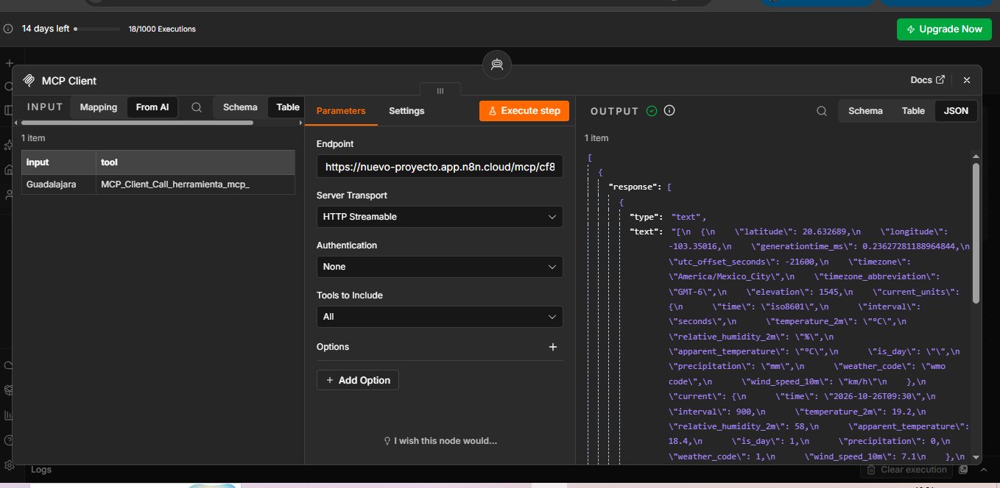

## 8.6. Gmail: envío del reporte

El último nodo del flujo principal envía el mensaje generado por el agente.

La configuración utilizada es:

- **Acción:** Send a message.
- **Asunto:** `Pronóstico diario del clima de Guadalajara`.
- **Cuerpo del mensaje:** `{{ $('AI Agent').item.json.output }}`

La expresión del cuerpo recupera el campo `output` del nodo AI Agent y lo utiliza como contenido del correo.

De esta manera, el correo contiene la salida generada por el agente y no un texto fijo escrito manualmente.

La cuenta de Gmail se autorizó para las operaciones necesarias de lectura, redacción y envío. No se concedió un permiso independiente para eliminar todos los correos.

Durante las pruebas, el correo llegó correctamente. Además, recibí la notificación del clima de las 8:00 a. m., lo que confirmó que el proceso de envío funcionó durante esa ejecución.

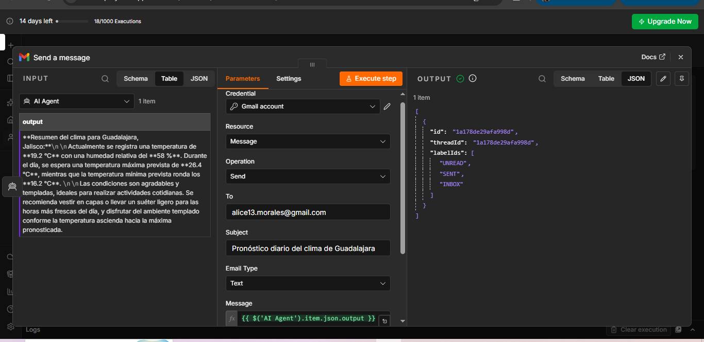

# 9. Desarrollo del servidor MCP

El servidor se creó en un flujo independiente llamado **Servidor MCP del Clima**.

La estructura es:

`MCP Server Trigger → Call n8n Workflow Tool`

Su finalidad es proporcionar acceso a la herramienta que ejecuta el flujo auxiliar.

## 9.1. MCP Server Trigger

MCP Server Trigger funciona como punto de entrada del servidor MCP. Permite que un cliente compatible establezca comunicación con el servidor y acceda a las herramientas expuestas.

En este proyecto se configuró con transporte HTTP Streamable y autenticación `None` durante las pruebas.

Esta configuración permitió realizar las pruebas en el entorno utilizado. Sin embargo, no debe considerarse adecuada para exponer el servidor públicamente sin controles de seguridad adicionales.

## 9.2. Call n8n Workflow Tool

Este nodo permite invocar otro flujo de n8n como herramienta.

En el proyecto se utiliza para conectar el servidor MCP con el flujo **Herramienta MCP - Datos del clima**.

Cuando la herramienta es solicitada, el flujo auxiliar ejecuta la consulta meteorológica y devuelve el resultado correspondiente.

Esta separación permite mantener la lógica de consulta en un flujo independiente del servidor.

# 10. Desarrollo de la herramienta MCP

La herramienta auxiliar se llama **Herramienta MCP - Datos del clima**.

Su estructura es:

`When Executed by Another Workflow → HTTP Request`

## 10.1. When Executed by Another Workflow

Este nodo permite que el flujo auxiliar se ejecute cuando otro flujo de n8n lo invoca.

En este caso, permite que la herramienta llamada desde el servidor MCP inicie la consulta meteorológica.

## 10.2. HTTP Request

Este nodo realiza una solicitud GET a Open-Meteo utilizando la dirección de la API configurada para el proyecto.

La respuesta contiene información meteorológica que la herramienta puede devolver al flujo que la solicitó.

Durante las pruebas se verificó que el flujo auxiliar pudiera obtener datos después de corregir el problema de la respuesta vacía.

## 10.3. Resultado de la herramienta

La herramienta MCP permite acceder a una consulta meteorológica mediante un flujo separado.

Su funcionamiento se comprobó después de corregir el problema encontrado durante las pruebas. No obstante, para documentar que el agente utilizó la herramienta en una ejecución concreta, es necesario revisar el registro de llamadas correspondiente.

# 11. Integración entre n8n, Gemini y MCP

La integración reúne tres elementos principales:

- **n8n:** coordina los flujos de trabajo y la transferencia de información.
- **Gemini:** genera el resumen a partir de los datos y las instrucciones.
- **MCP:** permite que el agente disponga de una herramienta externa para solicitar información.

El proceso general es el siguiente:

1. Schedule Trigger inicia el flujo principal según el horario establecido.
2. HTTP Request consulta la API de Open-Meteo.
3. Edit Fields selecciona los datos necesarios.
4. AI Agent recibe los datos y utiliza Gemini para generar el resumen.
5. El agente dispone de MCP Client Tool para solicitar información mediante la herramienta MCP.
6. MCP Server Trigger proporciona el punto de entrada del servidor.
7. Call n8n Workflow Tool permite ejecutar el flujo auxiliar.
8. When Executed by Another Workflow inicia la consulta auxiliar.
9. HTTP Request consulta Open-Meteo y devuelve la respuesta meteorológica.
10. Gmail utiliza la salida del agente como contenido del correo electrónico.

El flujo principal y la herramienta MCP pueden realizar consultas independientes a la API. Por ello, no se debe asumir que ambas consultas corresponden a una sola solicitud.

La integración permite demostrar cómo se puede combinar una automatización programada, un modelo de lenguaje y una herramienta externa dentro de un proyecto práctico.

# 12. Pruebas realizadas y resultados

Las pruebas permitieron revisar el funcionamiento de los nodos, la transferencia de datos, la integración del agente y el envío del correo.

## 12.1. Prueba del flujo principal

Se realizó una ejecución manual del flujo principal para comprobar que los nodos pudieran completar el proceso.

Durante esta prueba, los nodos finalizaron correctamente y se recibió el correo generado por la automatización.

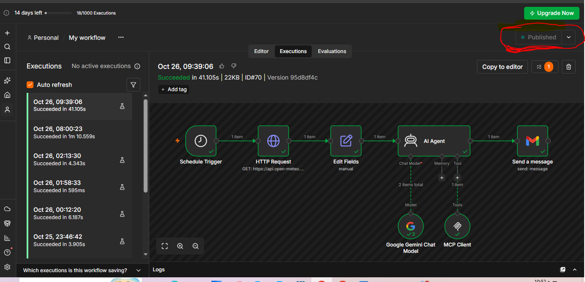 

## 12.2. Prueba de la API meteorológica

Se revisó la respuesta del nodo HTTP Request para verificar que Open-Meteo proporcionara información meteorológica.

Después se utilizaron las expresiones de Edit Fields para recuperar los campos seleccionados.

## 12.3. Prueba del agente de inteligencia artificial

Se comprobó que AI Agent generara una salida que pudiera utilizarse en el nodo Gmail.

El agente dispone de instrucciones para utilizar la herramienta MCP y comunicar si esta no está disponible o presenta un error.

## 12.4. Prueba del envío de Gmail

Se verificó que Gmail utilizara la salida del agente como cuerpo del mensaje.

El correo de prueba llegó correctamente. Además, la notificación del clima de las 8:00 a. m. llegó, lo que permitió comprobar que el flujo principal pudo completar el proceso de envío durante la ejecución correspondiente.

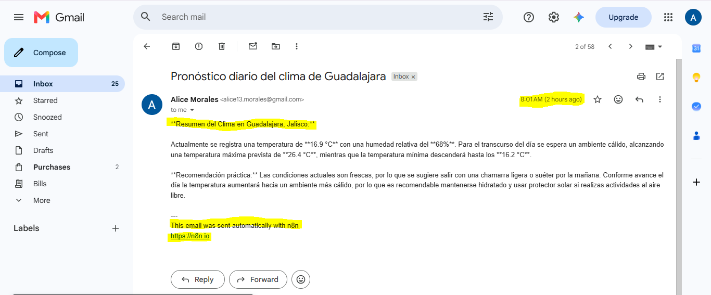

## 12.5. Prueba de la herramienta MCP

Durante las primeras pruebas, la herramienta MCP devolvió una respuesta vacía.

Después de revisar el flujo auxiliar y eliminar el nodo Edit Fields que no tenía campos configurados, se volvió a probar la herramienta.

En la prueba posterior se obtuvo información meteorológica en lugar de la respuesta vacía.

## 12.6. Resumen de resultados

| Prueba | Resultado observado |
|---|---|
| Ejecución manual del flujo principal | Los nodos finalizaron correctamente. |
| Consulta a Open-Meteo | Se obtuvo información meteorológica. |
| Organización de los datos | Se utilizaron los campos configurados en Edit Fields. |
| Generación del resumen | El agente produjo una salida para el correo. |
| Envío mediante Gmail | El correo llegó correctamente. |
| Notificación de las 8:00 a. m. | Se recibió el correo del clima. |
| Prueba inicial de MCP | La herramienta devolvió una respuesta vacía. |
| Corrección del flujo auxiliar | Se eliminó el nodo Edit Fields vacío. |
| Nueva prueba de MCP | La herramienta devolvió información meteorológica. |
| Publicación del flujo principal | El flujo quedó publicado con la programación configurada. |

Los resultados permiten concluir que el flujo principal funcionó durante las pruebas realizadas y que el problema de la respuesta vacía de MCP se corrigió.

El funcionamiento de futuras ejecuciones depende de que n8n, las credenciales y los servicios externos continúen disponibles.

# 13. Problema encontrado y solución

Durante la integración de MCP apareció un problema que fue necesario revisar antes de continuar.

## 13.1. ¿Qué ocurrió?

Al probar la herramienta MCP, la respuesta obtenida estaba vacía y no mostraba la información meteorológica que se esperaba recibir.

Esto indicó que era necesario revisar la configuración de los nodos y los datos que se estaban transfiriendo.

## 13.2. ¿Cómo se identificó el problema?

Al revisar el flujo auxiliar se encontró un nodo Edit Fields que no tenía campos configurados.

Ese nodo no aportaba información útil al proceso y estaba relacionado con el problema observado en la salida de la herramienta.

## 13.3. ¿Qué solución se aplicó?

Se eliminó el nodo Edit Fields vacío y se dejó la conexión entre When Executed by Another Workflow y HTTP Request.

Después de realizar el cambio, se volvió a ejecutar la prueba de la herramienta MCP.

## 13.4. ¿Cuál fue el resultado?

En la prueba posterior, la herramienta devolvió información meteorológica en lugar de la respuesta vacía.

Esta corrección permitió que el flujo auxiliar entregara datos útiles a la herramienta MCP.

## 13.5. ¿Qué aprendí de este problema?

El problema me permitió comprender que tener los nodos conectados no garantiza que la información se transfiera correctamente.

También aprendí la importancia de revisar la salida de cada nodo, identificar los componentes que no aportan información y volver a probar el flujo después de realizar una corrección.

La solución no consistió en rehacer el proyecto, sino en revisar el flujo auxiliar, eliminar el nodo innecesario y comprobar el resultado de la nueva ejecución.

# 14. Consideraciones de seguridad

La integración con servicios externos requiere proteger las credenciales y revisar los permisos concedidos.

En Gmail se autorizaron los permisos necesarios para leer, redactar y enviar correos. No se concedió un permiso independiente para eliminar todos los correos.

El servidor MCP se configuró con autenticación `None` durante las pruebas. Esta configuración no debe utilizarse como referencia para exponer el servidor públicamente sin controles adicionales.

Para utilizar un servidor MCP fuera de un entorno de prueba, es importante configurar un método de autenticación adecuado, limitar el acceso y proteger las credenciales.

También es recomendable revisar los permisos de cada integración y evitar compartir tokens, contraseñas o datos sensibles en capturas de pantalla o repositorios públicos.

# 15. Limitaciones y posibles mejoras

Aunque el proyecto funcionó durante las pruebas realizadas, existen aspectos que podrían mejorarse en una versión posterior.

## 15.1. Manejo de errores

Se podría agregar un tratamiento específico para los casos en los que Open-Meteo no responda o devuelva información incompleta.

Esto permitiría distinguir entre un problema de conexión, una respuesta inesperada y un error durante la generación del resumen.

## 15.2. Validación de los datos

Se podría verificar que los campos necesarios estén presentes antes de enviarlos al agente.

De esta forma, el flujo podría detectar datos faltantes y evitar que el agente genere un resumen basado en información incompleta.

## 15.3. Seguridad del servidor MCP

Se podría configurar autenticación y controles de acceso apropiados antes de utilizar el servidor fuera del entorno de prueba.

## 15.4. Verificación de las llamadas MCP

Se podría revisar y registrar cuándo el agente utiliza la herramienta MCP, qué resultado obtiene y si se presenta algún error.

Esto ayudaría a diferenciar las ejecuciones en las que el agente utiliza la herramienta de aquellas en las que genera una respuesta sin llamarla.

## 15.5. Reducción de consultas duplicadas

Como el flujo principal consulta Open-Meteo directamente y la herramienta MCP puede realizar otra consulta, se podría revisar la arquitectura para evitar solicitudes innecesarias cuando ambas operaciones no sean requeridas.

Estas mejoras no impiden reconocer el funcionamiento demostrado durante las pruebas. Son posibilidades para hacer que el proyecto sea más robusto y fácil de mantener.

# 16. Aprendizajes obtenidos

Con este proyecto aprendí a conectar diferentes nodos de n8n para construir una automatización completa.

También practiqué el uso de solicitudes HTTP para consultar una API, la selección de datos mediante expresiones y la utilización de la salida de un agente de inteligencia artificial como contenido de un correo electrónico.

La integración de MCP me permitió comprender la diferencia entre un cliente y un servidor, así como la función de una herramienta que puede ejecutar una consulta externa.

Durante las pruebas también comprendí que es necesario revisar los datos de entrada y salida de cada nodo. El problema de la respuesta vacía me permitió practicar la identificación de errores, corregir la configuración y comprobar el resultado después del cambio.

Finalmente, aprendí que una automatización no se valida únicamente por su apariencia o por la conexión entre los nodos. Es necesario ejecutarla, revisar sus resultados y comprobar que la tarea se complete correctamente.

# 17. Conclusión

El proyecto permitió desarrollar y probar una automatización para consultar información meteorológica de Guadalajara, organizar los datos, generar un resumen mediante inteligencia artificial y enviarlo por correo electrónico.

La integración de n8n, Open-Meteo, Gemini, MCP y Gmail permitió dividir el proceso en etapas y separar la automatización principal de la herramienta auxiliar.

Durante el desarrollo se presentó un problema en el que la herramienta MCP devolvía una respuesta vacía. Al revisar el flujo auxiliar, identifiqué un nodo Edit Fields que no tenía campos configurados. Después de eliminarlo y volver a probar la herramienta, obtuve información meteorológica en la respuesta.

El flujo principal quedó publicado y la notificación del clima de las 8:00 a. m. llegó correctamente. Esto permitió comprobar el funcionamiento del proceso durante la ejecución correspondiente.

El proyecto cumplió su objetivo práctico durante las pruebas realizadas y me permitió comprender cómo se pueden combinar la automatización de flujos de trabajo, las APIs, la inteligencia artificial y las herramientas MCP para resolver una tarea cotidiana.

# 18. Bibliografía

Anthropic. (s. f.). *Model Context Protocol (MCP)*. https://docs.anthropic.com/en/docs/build-with-mcp

Google. (s. f.). *Gemini API documentation*. Google AI for Developers. https://ai.google.dev/gemini-api/docs

Google. (s. f.). *Gmail API guides*. Google for Developers. https://developers.google.com/workspace/gmail/api/guides

Make. (s. f.). *Make*. https://www.make.com/

Model Context Protocol. (s. f.). *Introduction*. https://modelcontextprotocol.io/introduction

